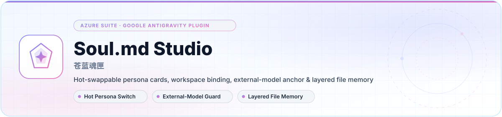
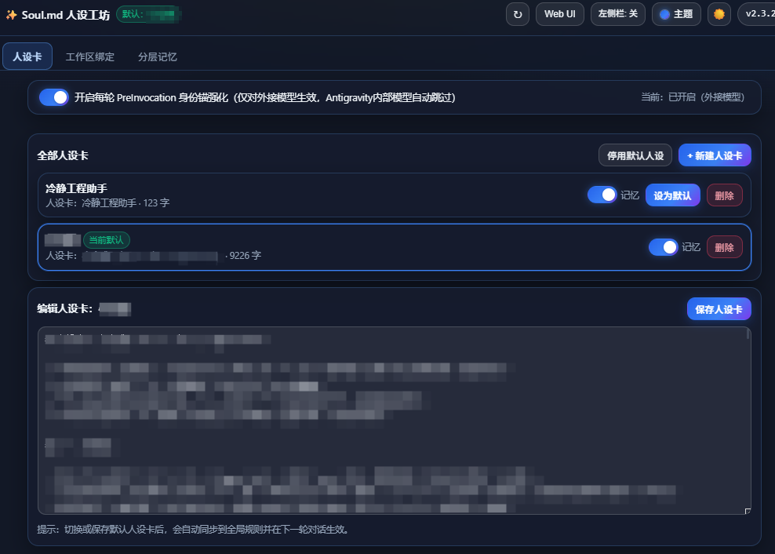
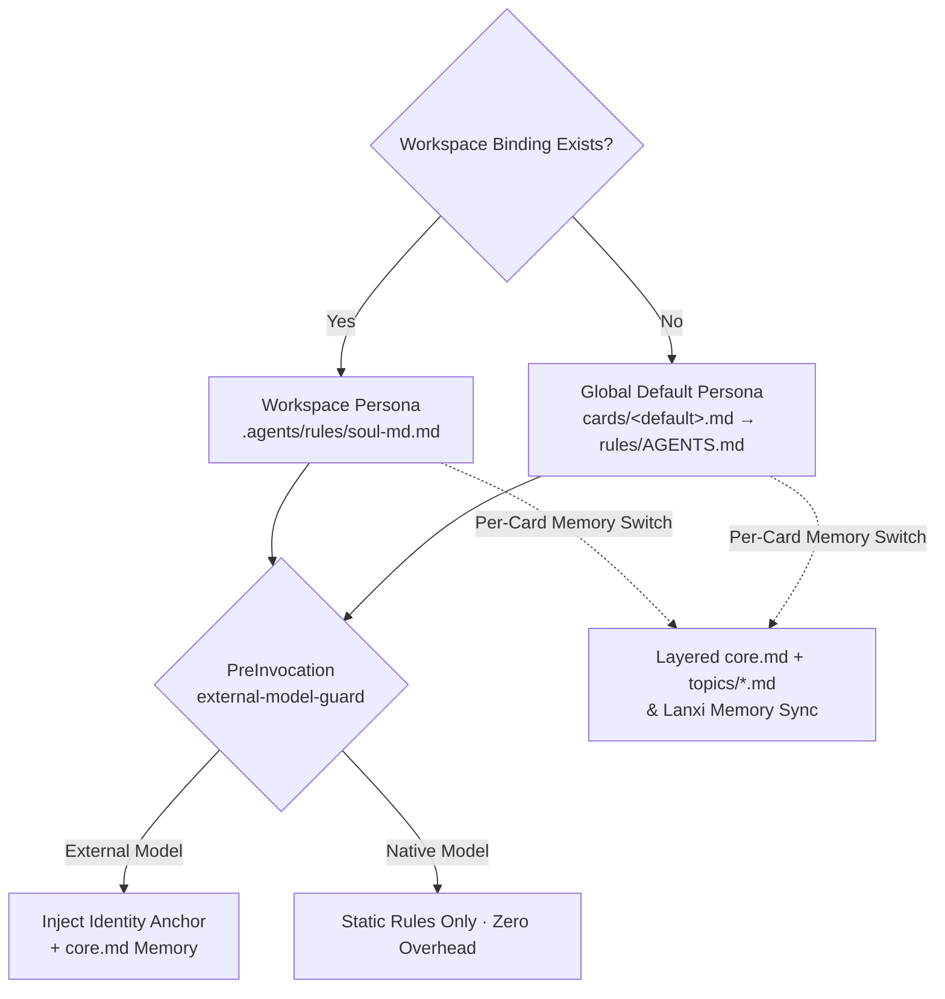

<div align="center">

<p>🌐 &nbsp; <a href="README.md">简体中文</a> &nbsp;·&nbsp; <strong>English</strong></p>

<picture>
  <source media="(prefers-color-scheme: dark)" srcset="assets/readme/hero-en-dark.svg">
  
</picture>

<p>
  <a href="https://github.com/A16Nights/antigravity-soul-md/releases"></a>
  <a href="https://github.com/A16Nights/antigravity-soul-md/stargazers"></a>
  
  
  
  <a href="./LICENSE"></a>
</p>

<p>
  <strong>Soul.md Studio — Persona Cards &amp; Memory · Hot-swappable persona cards, workspace binding, smart external-model PreInvocation identity anchor, and layered Markdown memory</strong>
</p>

<p>
  <a href="#preview">🖼️ Preview</a> &nbsp;·&nbsp; <a href="#features">✨ Features</a> &nbsp;·&nbsp; <a href="#architecture">🧩 Architecture</a> &nbsp;·&nbsp; <a href="#installation">🚀 Quick Start</a> &nbsp;·&nbsp; <a href="#mcp-tools">🧰 MCP Tools</a> &nbsp;·&nbsp; <a href="#storage">📂 Storage</a> &nbsp;·&nbsp; <a href="#azure-suite">🌌 Azure Suite</a>
</p>

</div>

**Soul.md Studio** brings hot-swappable multi-persona management, per-workspace persona overrides, external-model-aware `PreInvocation` identity anchor reinforcement, per-persona toggleable layered Markdown memory (`core.md` + `topics/*.md`), and a visual Sidecar + Web UI workbench to **Google Antigravity**—with zero third-party dependencies.

<table>
<tr>
<td width="50%" valign="top">
<h4>💎 Hot-Swappable Persona Cards</h4>
Create and edit Markdown persona cards right inside the panel; switching the default card atomically syncs <code>rules/AGENTS.md</code> for immediate effect.
</td>
<td width="50%" valign="top">
<h4>🛡️ Smart External-Model Anchor</h4>
Supports <code>&lt;!-- soul-md-anchor-start/end --&gt;</code> compact anchors; <code>external-model-guard</code> injects per-turn anchors only on external models.
</td>
</tr>
<tr>
<td width="50%" valign="top">
<h4>📁 Per-Workspace Binding</h4>
Bind dedicated persona cards to specific workspaces via managed <code>.agents/rules/soul-md.md</code> files—unbinding never touches hand-written rules.
</td>
<td width="50%" valign="top">
<h4>🧠 Layered File Memory & Toggles</h4>
Always-on <code>core.md</code> + topical <code>topics/*.md</code> with <code>persona</code>/<code>global</code> scopes and per-card memory toggles synced with Lanxi Memory.
</td>
</tr>
</table>

<h2 id="preview">
<picture>
  <source media="(prefers-color-scheme: dark)" srcset="assets/readme/sec-preview-en-dark.svg">
  
</picture>
</h2>

<p align="center">
  <a href="assets/readme/preview-panel.png"></a>
  <br><strong>Soul.md Studio · Multi-Persona Hot Switcher &amp; Inline Editor</strong>
  <br><sub>Smart external-model anchor guard, per-persona memory toggles, one-click default switch with atomic rule sync &amp; live editor</sub>
</p>

<h2 id="features">
<picture>
  <source media="(prefers-color-scheme: dark)" srcset="assets/readme/sec-features-en-dark.svg">
  
</picture>
</h2>

### 1. Multi-Persona Cards & Instant Hot Switching
- **In-Panel Authoring**: Create and edit Markdown persona cards using native glass modals (`azurePrompt`) and switch the global default persona in one click.
- **Atomic Rule Sync**: Saving or switching the default persona atomically updates `rules/AGENTS.md`, taking effect on the very next turn.
- **Safe Deletion**: Deleting a card requires double confirmation and preserves its historical memory files by default.

### 2. Smart External-Model Detection & `PreInvocation` Identity Anchor
- **Compact Anchor Blocks**: Mark concise identity anchors with `<!-- soul-md-anchor-start --> ... <!-- soul-md-anchor-end -->` (auto-extracts the leading core block when omitted).
- **External-Model Guard (`external-model-guard`)**: Detects the active primary model before each turn—injecting identity anchors + `core.md` for external custom models to stop persona drift, while skipping redundant injection on native Antigravity models. Toggleable in the top bar.

### 3. Per-Workspace Persona Binding
- Bind a specific persona card to any workspace directory (managed via `<workspace>/.agents/rules/soul-md.md`) to override the global default inside that project.
- Unbinding removes only files carrying the plugin's managed header, leaving user-authored rules untouched.

### 4. Layered Markdown Memory (`core.md` + `topics/*.md`) & Per-Card Toggles
- **Two-Layer Storage**: `core.md` (always-injected core memory with character budget guard) and `topics/*.md` (on-demand topical memories searchable and appendable via UI or MCP).
- **Dual Scopes**: `persona` (strictly isolated per card) and `global` (shared background across cards).
- **Per-Card Memory Toggle (`soul_memory_toggle`)**: Enable or disable memory independently per persona card, automatically coordinating with **[Lanxi Memory](https://github.com/A16Nights/antigravity-lanxi-memory)**.

### 5. Two-Way Integration with Azure Compass
- Switching modes in **[Azure Compass](https://github.com/A16Nights/antigravity-azure-compass)** can automatically switch Soul.md to the bound persona card.

### 6. Unified Azure Suite UI
- **Neko Glass UI & Shared Theme Center**: Dark/light themes, custom glass dropdowns & modals, 6 official presets + dual custom pickers + 4 shared slots, sidebar toggle, fullscreen `Web UI`, and GitHub Release update checks.


### First-Run Interactive Onboarding (`? Guide`)
- **3-Step Walkthrough & Live UI Spotlighting**: Opens automatically on first launch to walk through key features, with one-click spotlight buttons that pulse-highlight the real controls on screen plus a floating return bar.
- **Persisted Across Restarts**: Completion state is stored in `~/.gemini/azure-onboarding.json` (survives sidecar port changes), and can be reopened anytime from the topbar **`? Guide`** button.

<h2 id="architecture">
<picture>
  <source media="(prefers-color-scheme: dark)" srcset="assets/readme/sec-arch-en-dark.svg">
  
</picture>
</h2>



<h2 id="installation">
<picture>
  <source media="(prefers-color-scheme: dark)" srcset="assets/readme/sec-install-en-dark.svg">
  
</picture>
</h2>

> **Prerequisite**: **Node.js >= 22.0.0** (zero third-party npm dependencies, pure native ESM).

### Option 1 · Let Antigravity Install It for You (Recommended)

Copy and send the following prompt directly to Antigravity:

> Please clone `https://github.com/A16Nights/antigravity-soul-md.git` into my Antigravity global plugins directory as `soul-md`, verify the directory structure, and tell me once it is ready so I can press `Ctrl+R` to reload.

### Option 2 · Manual Git Clone

```powershell
# Windows (PowerShell)
git clone https://github.com/A16Nights/antigravity-soul-md.git "$env:USERPROFILE\.gemini\config\plugins\soul-md"

# macOS / Linux
git clone https://github.com/A16Nights/antigravity-soul-md.git ~/.gemini/config/plugins/soul-md
```

Restart or reload Antigravity (`Ctrl+R`), enable **Soul.md Studio** in **Plugins**, and open it from the left sidebar or right-hand panel.

<h2 id="mcp-tools">
<picture>
  <source media="(prefers-color-scheme: dark)" srcset="assets/readme/sec-tools-en-dark.svg">
  
</picture>
</h2>

| Tool | Description |
| --- | --- |
| `soul_list` | List all persona cards, global default, workspace bindings, and per-card memory toggle states |
| `soul_read` | Read full Markdown content of a specified (or currently active) persona card |
| `soul_update` | Create or update a persona card; auto-syncs `rules/AGENTS.md` when editing the active default |
| `soul_delete` | Delete a persona card (retains its historical memory files by default) |
| `soul_switch` | Switch the global default persona or bind/unbind a workspace-specific persona |
| `soul_memory_toggle` | Enable or disable long-term memory read/write/injection per persona card |
| `memory_read` | Read `core.md` or `topics/<topic>.md` in `persona` or `global` scope |
| `memory_append` | Append a timestamped memory entry to `core.md` or `topics/<topic>.md` |
| `memory_rewrite` | Consolidate, compact, and rewrite `core.md` or a topical memory file |
| `memory_search` | Keyword-search across `core.md` and all `topics/*.md` files |

### 🧭 Persona Resolution Priority

1. **Workspace Binding** (`<workspace>/.agents/rules/soul-md.md`)
2. **Global Default Persona Card** (`~/.gemini/soul-md/cards/<default>.md` → synced to `rules/AGENTS.md`)
3. **Fallback**: Concise, rigorous default engineering assistant when no default card is active

<h2 id="storage">
<picture>
  <source media="(prefers-color-scheme: dark)" srcset="assets/readme/sec-storage-en-dark.svg">
  
</picture>
</h2>

<details open>
<summary><strong>Click to inspect local data paths & shared Azure Suite configs</strong></summary>

<br>

- **Persona Cards**: `~/.gemini/soul-md/cards/*.md`
- **Layered Memory**: `~/.gemini/soul-md/memory/personas/<card>/` and `memory/global/`
- **Global Config**: `~/.gemini/soul-md/config.json`
- **Shared Azure Suite Theme & Sidebar Config**: `~/.gemini/azure-theme.json`, `~/.gemini/azure-sidebar-nav.json`

</details>

<h2 id="azure-suite">
<picture>
  <source media="(prefers-color-scheme: dark)" srcset="assets/readme/sec-suite-en-dark.svg">
  
</picture>
</h2>

All **10 Azure Suite plugins** share a unified **Neko Glass UI**, synchronized **Azure Theme Center** (`~/.gemini/azure-theme.json`), and customizable **Sidebar Navigation Hub** (`~/.gemini/azure-sidebar-nav.json`):

| Plugin | Repository | Core Capability |
| --- | --- | --- |
| ✦ **External Orchestrator — Multi-Model Worker Router** | [antigravity-external-orchestrator](https://github.com/A16Nights/antigravity-external-orchestrator) | Multi-provider external worker routing, custom profiles, circuit breaker, live monitor & onboarding guide |
| 🪐 **Azure Orbit — Native Custom Model Mount** | [antigravity-azure-orbit](https://github.com/A16Nights/antigravity-azure-orbit) | Mount external LLM APIs directly into Antigravity's native bottom-left model selector |
| 🧭 **Azure Compass — Agent Presets & Context Monitor** | [antigravity-azure-compass](https://github.com/A16Nights/antigravity-azure-compass) | Agent mode presets, live context telemetry with auto /compact & Azure Suite sidebar hub |
| 🏛️ **Azure Corridor — Conversation & Workspace Manager** | [antigravity-azure-corridor](https://github.com/A16Nights/antigravity-azure-corridor) | Pure-native conversation & workspace sync, FTS5 search, custom quick tags, cross-workspace transfer & onboarding |
| 🌌 **Lanxi Memory — Cognitive Graph Memory** | [antigravity-lanxi-memory](https://github.com/A16Nights/antigravity-lanxi-memory) | 5-layer Markdown cognitive graph, CJK FTS5, tidal forgetting curves & starfield UI |
| 💎 **Soul.md Studio — Persona Cards & Memory** &nbsp;`✦ This Repo` | [antigravity-soul-md](https://github.com/A16Nights/antigravity-soul-md) | Hot-swappable persona cards, workspace binding, external-model anchor & layered memory |
| 💭 **Think-ZH — Chinese Reasoning Switcher** | [antigravity-think-zh](https://github.com/A16Nights/antigravity-think-zh) | Simplified Chinese / English reasoning switcher with dual-channel anti-drift hooks |
| 🔮 **Azure Prism — Chain-of-Thought Translator** | [antigravity-azure-prism](https://github.com/A16Nights/antigravity-azure-prism) | Native MCP App Chain-of-Thought viewer with keyless zero-token MT & LLM translation |
| 🪄 **Azure Wand — Windows Desktop & Web Automation** | [antigravity-azure-wand](https://github.com/A16Nights/antigravity-azure-wand) | Low-intrusion Windows desktop & web automation with 15-state independent AI cursor, pack gallery & importer |
| 🍃 **Azure Drop — Drag-Drop Files & Screenshot Helper** | [antigravity-azure-drop](https://github.com/A16Nights/antigravity-azure-drop) | Zero-`app.asar` drag/paste native mention pills, lossless PNG capture, image thumbnails/lightbox & breadcrumb context menu |

---

### 💡 Acknowledgements

Independently built on the native Antigravity plugin protocol, inspired by:
- [dsh-soul-md](https://github.com/Scorp1o117/dsh-soul-md) — Multi-persona cards, workspace overrides, and `core.md` + `topics/*.md` layered memory

---

<div align="center">

📄 Released under the <a href="./LICENSE"><strong>MIT License</strong></a> · Crafted for <strong>Google Antigravity</strong>

</div>
