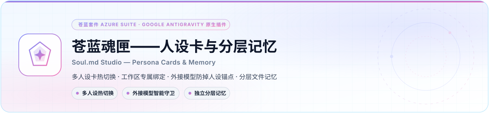
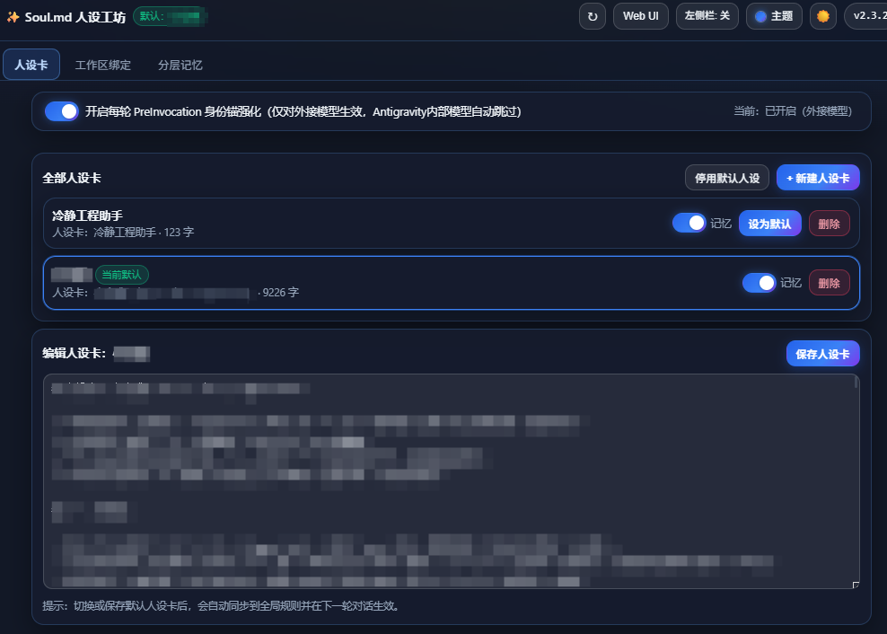
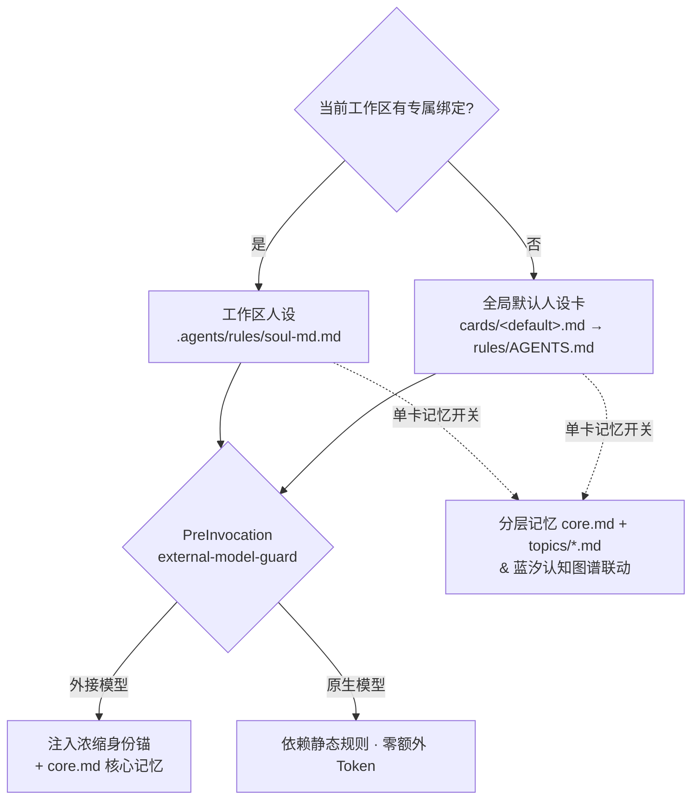

<div align="center">

<p>🌐 &nbsp; <strong>简体中文</strong> &nbsp;·&nbsp; <a href="README.en.md">English</a></p>

<picture>
  <source media="(prefers-color-scheme: dark)" srcset="assets/readme/hero-dark.svg">
  
</picture>

<p>
  <a href="https://github.com/A16Nights/antigravity-soul-md/releases"></a>
  <a href="https://github.com/A16Nights/antigravity-soul-md/stargazers"></a>
  
  
  
  <a href="./LICENSE"></a>
</p>

<p>
  <strong>多人设卡热切换 · 工作区专属绑定 · 外接模型智能防掉人设锚点 · 分层文件记忆（core.md + topics/*.md）</strong>
</p>

<p>
  <a href="#preview">🖼️ 界面预览</a> &nbsp;·&nbsp; <a href="#features">✨ 功能全景</a> &nbsp;·&nbsp; <a href="#architecture">🧩 工作原理</a> &nbsp;·&nbsp; <a href="#installation">🚀 快速安装</a> &nbsp;·&nbsp; <a href="#mcp-tools">🧰 MCP 工具</a> &nbsp;·&nbsp; <a href="#storage">📂 数据存储</a> &nbsp;·&nbsp; <a href="#azure-suite">🌌 苍蓝全家桶</a>
</p>

</div>

**苍蓝魂匣（Soul.md）** 为 **Google Antigravity** 提供可热切换的多人设卡管理、工作区专属人设绑定、外接模型智能识别的 `PreInvocation` 底层身份锚防掉线强化、按人设独立开关的分层文件记忆（`core.md` + `topics/*.md`），以及可视化侧栏工作台（Sidecar + 独立 Web UI）。零第三方依赖，纯 Node.js 原生运行。

<table>
<tr>
<td width="50%" valign="top">
<h4>💎 多人设卡管理与一键热切换</h4>
面板内毛玻璃弹窗随时新建/编辑 Markdown 人设卡，切换默认卡自动原子同步写入 <code>rules/AGENTS.md</code>，下一轮对话即刻生效。
</td>
<td width="50%" valign="top">
<h4>🛡️ 外接模型智能身份锚防掉线</h4>
支持 <code>&lt;!-- soul-md-anchor-start/end --&gt;</code> 浓缩身份锚，通过 <code>external-model-guard</code> 仅在外接模型下每轮强化注入，原生模型零额外开销。
</td>
</tr>
<tr>
<td width="50%" valign="top">
<h4>📁 工作区专属人设绑定</h4>
为指定项目目录生成受管 <code>.agents/rules/soul-md.md</code> 覆盖全局默认人设；解绑时仅清理插件受管文件，绝不误删手写规则。
</td>
<td width="50%" valign="top">
<h4>🧠 分层文件记忆 & 单卡独立开关</h4>
支持 <code>core.md</code> 常驻核心记忆 + <code>topics/*.md</code> 主题记忆、<code>persona</code>/<code>global</code> 双作用域，并与蓝汐自动联动记忆开关。
</td>
</tr>
</table>

<h2 id="preview">
<picture>
  <source media="(prefers-color-scheme: dark)" srcset="assets/readme/sec-preview-dark.svg">
  
</picture>
</h2>

<p align="center">
  <a href="assets/readme/preview-panel.png"></a>
  <br><strong>苍蓝魂匣 · Soul.md 多人设卡热切换与在线编辑工坊</strong>
  <br><sub>外接模型智能身份锚强化开关、单人设独立记忆开关、一键设为默认并原子同步全局规则，支持在线编辑保存</sub>
</p>

<h2 id="features">
<picture>
  <source media="(prefers-color-scheme: dark)" srcset="assets/readme/sec-features-dark.svg">
  
</picture>
</h2>

### 1. 多人设卡管理与一键热切换
- **自由创建与在线编辑**：通过面板内毛玻璃输入弹窗（`azurePrompt`）随时新建人设卡、在线编写 Markdown 设定并实时保存，支持一键切换全局默认人设卡。
- **原子同步生效规则**：切换或保存默认人设卡时，自动原子同步写入 `rules/AGENTS.md`，下一轮对话立即生效。
- **安全删除保护**：删除人设卡需经面板内毛玻璃确认弹窗二次确认，且默认保留该人设关联的历史记忆文件不丢失。

### 2. 外接模型智能识别与 `PreInvocation` 底层身份锚防掉线
- **自定义核心锚点区块**：支持在人设卡中使用 `<!-- soul-md-anchor-start --> ... <!-- soul-md-anchor-end -->` 标记高浓缩身份锚（未标记时自动智能提取前段核心设定）。
- **外接模型限定强化（`external-model-guard`）**：
  - 每轮调用前自动检测当前主模型：当使用外接自定义模型（如苍蓝星轨挂载模型）时，自动前置注入底层身份锚与核心记忆，彻底根治长对话或外接模型掉人设、变客服腔的问题；
  - 当使用 Antigravity 内置原生模型时，依靠静态 `rules/AGENTS.md` 即可稳定保持人设，自动跳过每轮重复注入以节省上下文 Token；
  - 支持在面板顶栏一键开关每轮强化。

### 3. 工作区（Workspace）专属人设绑定
- 支持为特定项目工作区目录绑定专属人设卡（自动生成并维护 `<workspace>/.agents/rules/soul-md.md`），在该项目内自动覆盖全局默认人设；
- 解绑时仅清理带有插件受管标记的文件，绝不误删用户手写的其他工作区规则。

### 4. 分层 Markdown 文件记忆（`core.md` + `topics/*.md`）与独立记忆开关
- **双层结构**：
  - `core.md`（核心常驻记忆）：随当前人设自动注入上下文（带字符预算上限保护）；
  - `topics/*.md`（按主题拆分的扩展记忆）：通过面板或 MCP 工具按需新建主题、检索关键词、追加带时间戳记录或整理重写。
- **双作用域支持**：支持 `persona`（按人设卡完全隔离，互不串戏）与 `global`（所有人设共享通用背景）两种记忆作用域。
- **单卡独立记忆开关（`soul_memory_toggle`）**：可为每张人设卡单独开启或关闭长期记忆（例如角色扮演人设开启记忆，纯代码评审人设关闭记忆），并与 **[蓝汐（Lanxi Memory）](https://github.com/A16Nights/antigravity-lanxi-memory)** 自动联动。

### 5. 与「苍蓝罗盘」模式预设双向联动
- 在 **[苍蓝罗盘（Azure Compass）](https://github.com/A16Nights/antigravity-azure-compass)** 中切换工作模式（如从「日常陪伴模式」切到「冷静工程模式」）时，可自动触发苍蓝魂匣同步切换对应的人设卡。

### 6. 苍蓝统一视觉与交互体系
- **Neko Glass 毛玻璃界面 & 苍蓝主题色调中心**：深色/浅色切换、自定义毛玻璃下拉框（`AzureSelect`）与新建/删除面板内弹窗、6 套官方配色预设 + 自定义双色 + 4 个自定义栏位跨插件同步、左侧栏快捷入口开关、独立浏览器全屏 `Web UI` 与 GitHub Release 在线更新检查。

<h2 id="architecture">
<picture>
  <source media="(prefers-color-scheme: dark)" srcset="assets/readme/sec-arch-dark.svg">
  
</picture>
</h2>



<h2 id="installation">
<picture>
  <source media="(prefers-color-scheme: dark)" srcset="assets/readme/sec-install-dark.svg">
  
</picture>
</h2>

> **前置要求**：**Node.js >= 22.0.0**（零第三方 npm 运行时依赖，纯 Node.js 原生 ESM 实现）。

### 方式一 · 一句话让 Antigravity 帮你自动安装（推荐）

直接把下面这句话发给 Antigravity 即可自动完成克隆与核验：

> 帮我把 `https://github.com/A16Nights/antigravity-soul-md.git` 克隆到本机 Antigravity 全局插件目录，目录名设为 `soul-md`，检查目录无误后告诉我，我再按 `Ctrl+R` 重载生效。

### 方式二 · 命令行手动克隆

```powershell
# Windows (PowerShell)
git clone https://github.com/A16Nights/antigravity-soul-md.git "$env:USERPROFILE\.gemini\config\plugins\soul-md"

# macOS / Linux
git clone https://github.com/A16Nights/antigravity-soul-md.git ~/.gemini/config/plugins/soul-md
```

重启或重载 Antigravity（`Ctrl+R`），在 **Plugins** 页面启用 **苍蓝魂匣** 即可从左侧栏或右侧辅助面板打开。

<h2 id="mcp-tools">
<picture>
  <source media="(prefers-color-scheme: dark)" srcset="assets/readme/sec-tools-dark.svg">
  
</picture>
</h2>

| 工具名 | 作用 |
| --- | --- |
| `soul_list` | 列出所有人设卡、当前全局默认卡、工作区绑定映射与各卡独立记忆开关状态 |
| `soul_read` | 读取指定人设卡（或当前生效卡）的完整 Markdown 内容 |
| `soul_update` | 创建或更新人设卡内容，若为当前默认卡则自动同步至生效规则文件 |
| `soul_delete` | 删除指定人设卡（默认保留其历史记忆文件） |
| `soul_switch` | 切换全局默认人设卡，或为指定工作区绑定 / 解绑专属人设卡 |
| `soul_memory_toggle` | 按人设卡单独开启或关闭长期记忆读写与注入 |
| `memory_read` | 读取指定作用域（`persona`/`global`）的 `core.md` 或 `topics/<topic>.md` |
| `memory_append` | 向 `core.md` 或指定 `topics/<topic>.md` 追加带时间戳的记忆段落 |
| `memory_rewrite` | 整理、压缩并重写 `core.md` 或指定主题记忆文件正文 |
| `memory_search` | 跨 `core.md` 与所有 `topics/*.md` 按关键词快速检索历史记忆片段 |

### 🧭 人设生效优先级

1. **当前工作区专属绑定**（`<workspace>/.agents/rules/soul-md.md`）
2. **全局默认人设卡**（`~/.gemini/soul-md/cards/<default>.md` → 同步至 `rules/AGENTS.md`）
3. **无默认卡或禁用**：自动回退为简洁严谨的默认工程助手

<h2 id="storage">
<picture>
  <source media="(prefers-color-scheme: dark)" srcset="assets/readme/sec-storage-dark.svg">
  
</picture>
</h2>

<details open>
<summary><strong>点击展开查看本机数据目录与苍蓝套件共享配置路径</strong></summary>

<br>

- **人设卡存储目录**：`~/.gemini/soul-md/cards/*.md`
- **分层记忆存储目录**：`~/.gemini/soul-md/memory/personas/<card>/` 与 `memory/global/`
- **魂匣全局配置**：`~/.gemini/soul-md/config.json`
- **苍蓝套件共享主题 / 左侧栏配置**：`~/.gemini/azure-theme.json`、`~/.gemini/azure-sidebar-nav.json`

</details>

<h2 id="azure-suite">
<picture>
  <source media="(prefers-color-scheme: dark)" srcset="assets/readme/sec-suite-dark.svg">
  
</picture>
</h2>

**苍蓝套件（Azure Suite）** 10 款插件共享统一的 **Neko Glass 毛玻璃界面**、跨插件同步的 **苍蓝主题色调中心**（`~/.gemini/azure-theme.json`）以及可自由开关的 **左侧栏快捷入口**（`~/.gemini/azure-sidebar-nav.json`）：

| 插件 | 仓库 | 核心能力 |
| --- | --- | --- |
| ✦ **苍蓝协奏台** | [antigravity-external-orchestrator](https://github.com/A16Nights/antigravity-external-orchestrator) | 多渠道外部模型协同调度、自定义调度角色、容灾断路器与全链路实时监控 |
| 🪐 **苍蓝星轨** | [antigravity-azure-orbit](https://github.com/A16Nights/antigravity-azure-orbit) | 将外部大模型直接挂载进 Antigravity 左下角原生模型下拉菜单担任主脑 |
| 🧭 **苍蓝罗盘** | [antigravity-azure-compass](https://github.com/A16Nights/antigravity-azure-compass) | Agent 工作模式预设中心、上下文水位监测与自动 /compact、苍蓝套件左侧栏总控 |
| 🏛️ **苍蓝回廊** | [antigravity-azure-corridor](https://github.com/A16Nights/antigravity-azure-corridor) | 纯官方原生会话与工作区同步管理、FTS5 全文检索、跨工作区转移续聊、官方具体模型选择与官方归档箱 |
| 🌌 **蓝汐 · 潮汐认知图谱** | [antigravity-lanxi-memory](https://github.com/A16Nights/antigravity-lanxi-memory) | 五层纯 Markdown 真源记忆、CJK FTS5、潮汐遗忘曲线与交互式潮汐星海图谱 |
| 💎 **苍蓝魂匣** &nbsp;`✦ 当前仓库` | [antigravity-soul-md](https://github.com/A16Nights/antigravity-soul-md) | 多人设卡热切换、工作区专属绑定、外接模型智能防掉线锚点与分层文件记忆 |
| 💭 **思语中文** | [antigravity-think-zh](https://github.com/A16Nights/antigravity-think-zh) | 内部思考语言简体中文 / 英文双档热切换、双通道防漂移与实时注入预览 |
| 🔮 **苍蓝棱镜** | [antigravity-azure-prism](https://github.com/A16Nights/antigravity-azure-prism) | 原生 MCP App 思维链实时观测、免密钥零 Token 机翻与外部模型双通道译文 |
| 🪄 **苍蓝魔杖** | [antigravity-azure-wand](https://github.com/A16Nights/antigravity-azure-wand) | Windows 桌面与网页低打扰操控台、独立输入 15 状态 AI 光标、套装画廊混搭与外部光标导入 |
| 🍃 **苍蓝流笺** | [antigravity-azure-drop](https://github.com/A16Nights/antigravity-azure-drop) | 零 `app.asar` 侵入、拖拽与粘贴插入原生文件标签、无损 PNG 截图落盘、图片缩略图灯箱与顶栏面包屑右键菜单 |

---

### 💡 灵感致谢

本项目为基于 Antigravity 插件协议独立设计与编写的原生实现，功能设计灵感源自：
- [dsh-soul-md](https://github.com/Scorp1o117/dsh-soul-md) —— 多人设卡、工作区覆盖及 `core.md` + `topics/*.md` 分层记忆理念

---

<div align="center">

📄 Released under the <a href="./LICENSE"><strong>MIT License</strong></a> · Crafted for <strong>Google Antigravity</strong>

</div>
